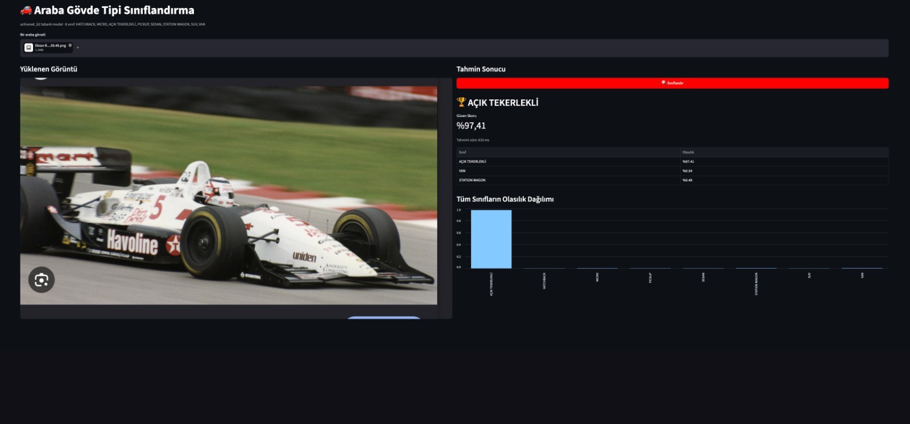
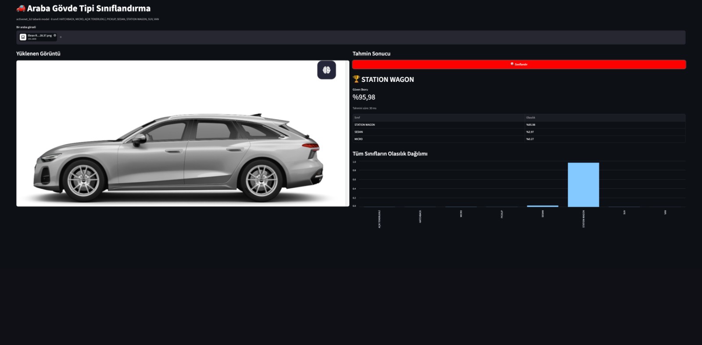
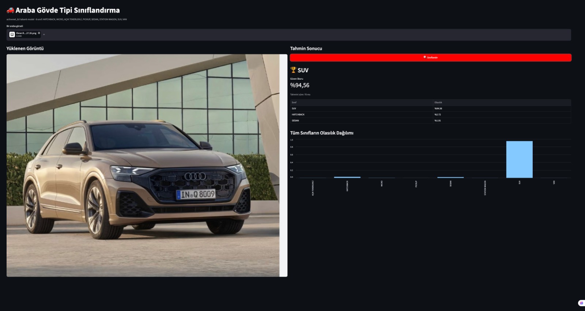
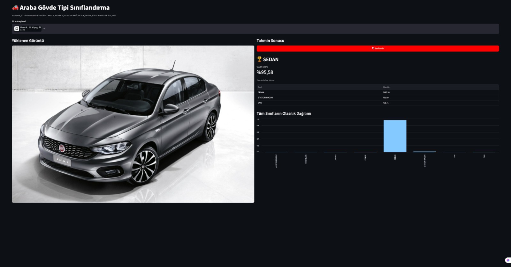
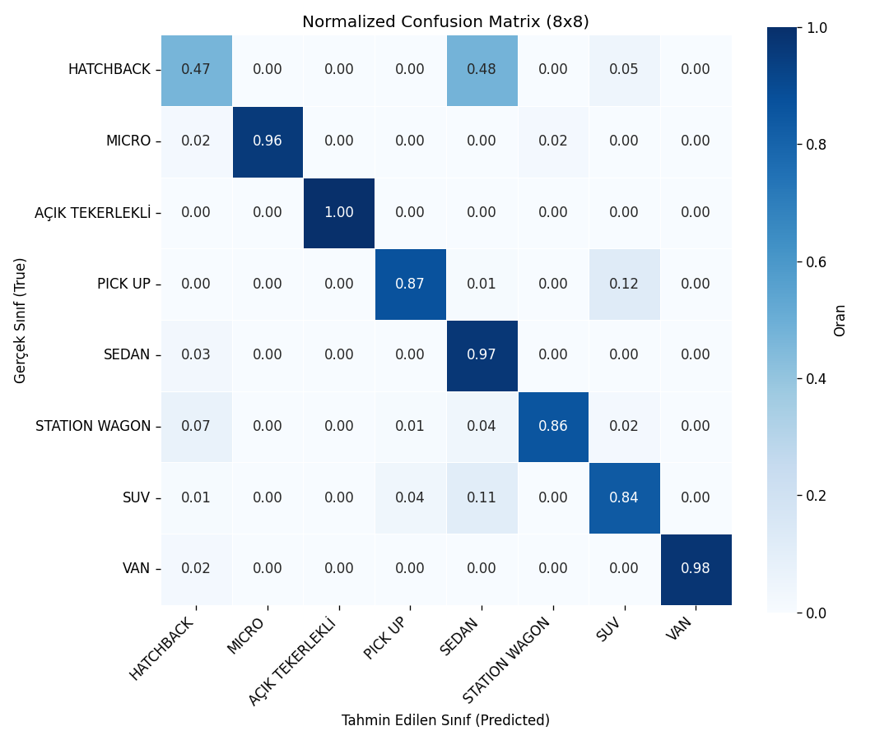

# Araba Gövde Tipi Sınıflandırma

[](https://github.com/selimdogann/araba-govde-tipi-siniflandirma/actions/workflows/tests.yml)

Bir araba fotoğrafından gövde tipini bulan derin öğrenme projesi. 8 sınıf var: SUV, VAN,
STATION WAGON, MICRO, AÇIK TEKERLEKLİ, SEDAN, HATCHBACK, PICK UP.
EfficientNet-B0 transfer learning ile eğitildi. Test kümesinde **macro F1 0,867**.

Kocaeli Üniversitesi, Bilgisayar Mühendisliği, Yazılım Laboratuvarı-II / Proje III.

## Ne yapıyor?

1. Streamlit arayüzünde bir araba fotoğrafı yüklersiniz; görsel solda görünür.
2. **Sınıflandır**'a basınca model gövde tipini, güven skorunu ve tahmin süresini gösterir.
3. En olası 3 tip tabloda, 8 tipin tamamı çubuk grafikte yer alır.
4. Model iki tip arasında kaldıysa (en sık HATCHBACK ↔ SEDAN) bunu bir uyarıyla söyler.

Gerçek modelle alınmış örnek tahminler:

| Açık tekerlekli · %97 | Station wagon · %96 |
|---|---|
|  |  |

| SUV · %95 | Sedan · %96 |
|---|---|
|  |  |

## Hızlı başlangıç

```bash
git clone https://github.com/selimdogann/araba-govde-tipi-siniflandirma.git
cd araba-govde-tipi-siniflandirma
python3 -m venv .venv
source .venv/bin/activate
pip install -r requirements.txt
```

### Model dosyası

Eğitilmiş model (`best_model.pt`, ~16 MB) boyut nedeniyle repoda yok. İki seçenek var:

- Hazır dosyayı `outputs/checkpoints/best_model.pt` yoluna koyun, ya da başka bir yerdeyse
  `MODEL_PATH=/yol/best_model.pt` ortam değişkeniyle gösterin.
- Ya da veri setini indirip modeli kendiniz eğitin ([Eğitim](#eğitim)).

### Arayüzü çalıştırma

```bash
streamlit run app/app.py            # http://localhost:8501
python predict.py yol/araba.jpg     # komut satırından tek fotoğraf
python predict.py yol/araba.jpg --json
```

Kendi kodunuzdan çağırmak için:

```python
from src.inference import Predictor

predictor = Predictor()                       # varsayılan model yolu
result = predictor.predict_path("araba.jpg")
print(result["pred_label"], result["confidence"])
```

## Sonuçlar (test kümesi, 788 görüntü)

| Metrik | Değer |
|--------|-------|
| **Macro F1** (1. öncelik) | **0,867** |
| Weighted F1 | 0,866 |
| Accuracy | 0,867 |

Sınıf bazlı F1:

| Sınıf | F1 | Sınıf | F1 |
|---|---|---|---|
| AÇIK TEKERLEKLİ | 1,00 | PICK UP | 0,91 |
| VAN | 0,99 | SUV | 0,83 |
| MICRO | 0,98 | SEDAN | 0,75 |
| STATION WAGON | 0,91 | HATCHBACK | 0,58 |

**En zayıf nokta:** gerçek HATCHBACK'lerin yarısına yakını (%48) SEDAN olarak tahmin
ediliyor. İki tip yandan bakınca çok benziyor. Arayüz bu durumda kullanıcıyı uyarıyor.
Tüm sayılar `outputs/metrics.json` ve `outputs/classification_report.txt` içinde.



## Veri seti

Görseller `data/` altında, her sınıf bir klasör olacak şekilde durur:

```
data/
├── hatchback/      ├── sedan/
├── micro/          ├── station_wagon/
├── open_wheel/     ├── suv/
├── pickup/         └── van/
```

- Kaynak: Kaggle'daki "Cars Body Type Cropped" ve "Stanford Car Body Type Data" veri setleri
  temel alınarak hazırlanan özel bir veri seti.
- 5253 görsel, sınıf başına 597–680 (dengesizlik oranı 1,14x).
- `data/` klasörü `.gitignore` ile dışarıda tutulur; görseller GitHub'a yüklenmez.

```bash
python scripts/analyze_dataset.py            # sınıf dengesi + split özeti + grafikler
python scripts/analyze_dataset.py --verify   # ek olarak bozuk görüntü taraması
```

## Eğitim

```bash
python train.py --freeze-epochs 3            # sonuçlardaki ayar: 3 epoch head ısıtma + ince ayar
python train.py --epochs 40 --lr 5e-4 --dropout 0.4 --batch-size 32
python train.py --arch mobilenet_v3_large    # mimariyi değiştir
python train.py --smoke-test                 # 2 epoch x 2 batch hızlı kontrol
```

- **Mimari:** EfficientNet-B0 (ImageNet ağırlıklarıyla transfer learning). Ayrıca
  `mobilenet_v3_large`, `mobilenet_v3_small`, `resnet18` desteklenir. Hepsi 95 MB sınırının altında.
- **Ön işleme:** 224×224, ImageNet mean/std normalizasyonu.
- **Veri çoğaltma (yalnız eğitimde):** RandomResizedCrop, yatay çevirme, ±15° döndürme,
  ColorJitter, küçük öteleme, RandomErasing.
- **Bölme:** stratified %70 eğitim / %15 doğrulama / %15 test, sabit tohum (42).
- **EarlyStopping:** doğrulama macro F1'i izlenir; iyileşme durunca eğitim biter.
- **Çıktılar:** `outputs/checkpoints/best_model.pt`, `outputs/logs/training_log.csv`,
  `outputs/logs/history.json`.
- Ayarlanabilir: `--epochs`, `--batch-size`, `--lr`, `--weight-decay`, `--dropout`,
  `--label-smoothing`, `--patience`, `--freeze-epochs`, `--data-dir`, `--output-dir`.

## Değerlendirme

```bash
python evaluate.py                 # test kümesinde metrikler + 3 grafik
python evaluate.py --split val     # doğrulama kümesinde
```

Üretilenler: `outputs/metrics.json`, `outputs/classification_report.txt` ve
`outputs/figures/` altında `loss_curve.png`, `accuracy_curve.png`, `confusion_matrix.png`.

## Testler

```bash
pip install -r requirements-dev.txt
pytest
```

39 test var. Gerçek veri seti ve model gerekmez: testler minik bir sahte veri seti ve
rastgele ağırlıklı bir model üretip hattın uçtan uca çalıştığını doğrular. Kapsam:

- **Veri:** sınıf sırası, dönüşümler, bölmeler arası sızıntı olmaması, her sınıfın teste girmesi.
- **Model:** 4 mimarinin çıktısı, backbone dondurma, EarlyStopping, metrikler.
- **Tahmin:** olasılıkların toplamı, farklı renk modları, telefon fotoğrafının EXIF yönü.
- **Komut satırı:** `predict.py` hata mesajları, `train.py --smoke-test` → `evaluate.py`.
- **Arayüz:** model yokken hata mesajı, yükleme bekleme durumu, Türkçe yüzde biçimi, kararsızlık kuralı.

Her push ve PR'da GitHub Actions aynı testleri çalıştırır.

## Proje yapısı

```
.
├── app/
│   ├── app.py                  # Streamlit arayüzü
│   └── ui.py                   # Yüzde biçimi ve kararsızlık kuralı
├── .streamlit/config.toml      # Tema: koyu zemin, kırmızı buton
├── src/
│   ├── config.py               # Tüm sabitler (sınıflar, yollar, boyutlar)
│   ├── data/dataset.py         # Dönüşümler + stratified split + DataLoader
│   ├── models/model.py         # Mimari kurucu, dondurma, checkpoint yükleme
│   ├── engine.py               # Eğitim/değerlendirme döngüleri, cihaz seçimi
│   ├── inference.py            # Predictor: tek görüntü tahmini
│   └── utils/                  # Analiz, EarlyStopping, metrikler, grafikler
├── scripts/analyze_dataset.py  # Veri seti raporu
├── train.py                    # Eğitim
├── evaluate.py                 # Değerlendirme + grafikler
├── predict.py                  # Komut satırından tahmin
├── tests/                      # pytest testleri
├── outputs/                    # Metrikler ve grafikler (model dosyası gitignored)
└── data/                       # Veri seti (gitignored)
```

## Lisans

MIT. Ayrıntı için [LICENSE](LICENSE).
